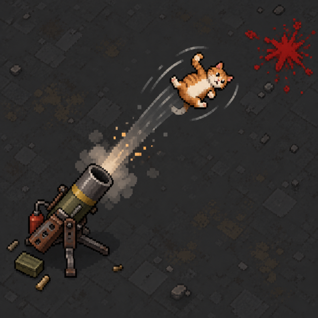

# Cat Launcher

[](https://github.com/actowery/CatLauncher/actions/workflows/ci.yml)
[](https://codecov.io/gh/actowery/CatLauncher)
[](https://github.com/actowery/CatLauncher/actions/workflows/codeql.yml)
[](LICENSE)



A standalone RimWorld mod by **konduct** for RimWorld **1.6** and **1.7 unstable**. Build a reusable launcher at the machining table after researching Machining, then fire spinning, randomly tinted cat shells with frag-grenade-equivalent impact damage.

## Features

- 24-tile range, 2.5-second warmup, 3-second cooldown, and 1.9-tile Bomb explosion.
- Flying cats visibly spin in a randomly chosen orange, dark, cream, or brown tint.
- Cleanable vanilla blood and short-lived, non-selectable cat fragments at impact.
- A configurable survivor-cat chance; survivors appear outside the resolved blast radius, are lightly injured, and match the launched cat's tint.
- Configurable bloodiness from 0–300%.
- No runtime dependencies and no ordinary-shot consumption, harm, or spawning of real cats.

## Installation and use

Subscribe on Steam Workshop or unpack a [GitHub release](https://github.com/actowery/CatLauncher/releases) into RimWorld's `Mods` folder. Enable Cat Launcher, research Machining, craft **Cat Launcher** at a machining table, and equip it.

Open the Mod Settings menu to adjust survivor chance (default 1%) and bloodiness (default 100%).

## Building

Install the .NET 10 SDK selected by `global.json`, then run:

```powershell
dotnet restore CatLauncher.slnx --locked-mode
dotnet build Source/CatLauncher/CatLauncher.csproj --configuration Release --no-restore
dotnet test Tests/CatLauncher.Tests/CatLauncher.Tests.csproj --configuration Release --no-restore
./scripts/validate-package.ps1 -RequireBinaries
./scripts/package.ps1
```

Compiled assemblies are placed in `1.6/Assemblies` and `1.7/Assemblies`. The release archive and checksum are written to `outputs/`.

## Quality and compatibility

Pull requests must maintain at least 90% project coverage and 95% changed-line coverage. CI builds both supported RimWorld targets, validates the package, produces a release archive, uploads coverage to Codecov, runs CodeQL and dependency review, and includes a weekly 1.7 compatibility canary.

The mod stores only the tint for a rare survivor cat. Removing the mod is safe; that survivor returns to its normal vanilla cat appearance.

See [MANUAL_TESTS.md](MANUAL_TESTS.md) for in-game verification.

## License

MIT. See [LICENSE](LICENSE).
